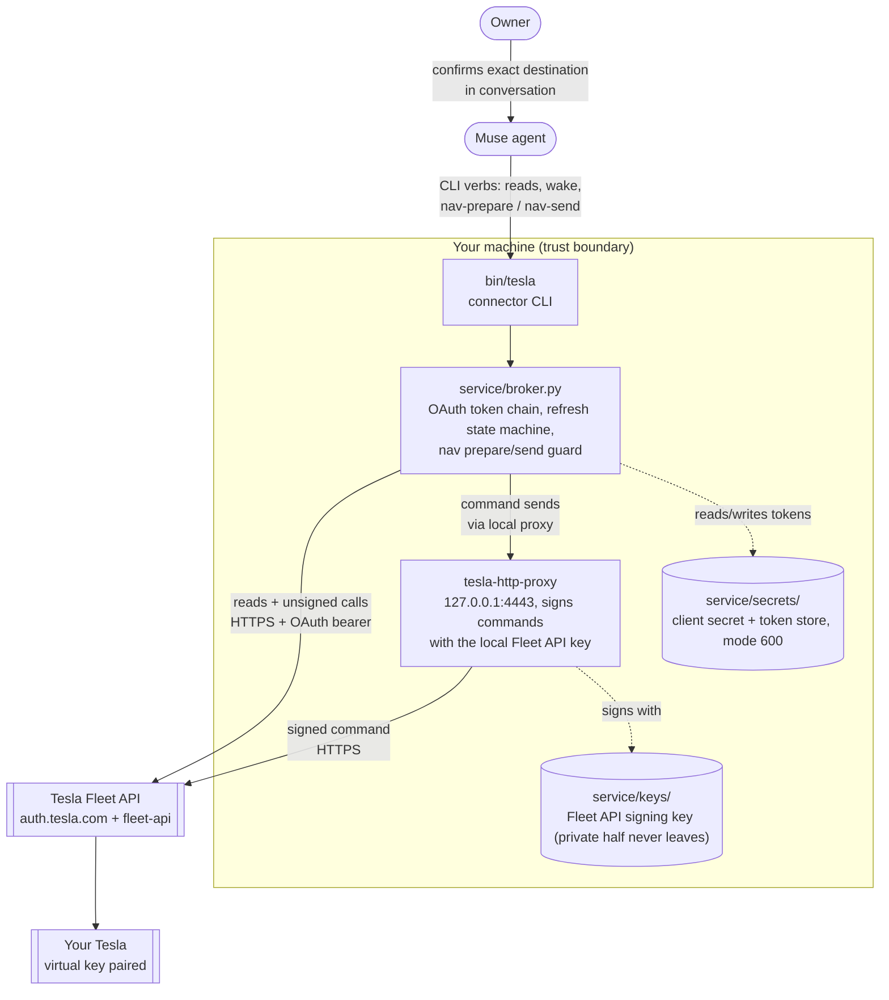

**English** | [简体中文](README.zh-CN.md)

<div align="center">

# Muse Tesla Connector — Free

**The hosted Tesla connectors charge a monthly subscription — per car — and hold your Tesla tokens on their servers. This one doesn't: connect your Tesla to your Muse agent through Tesla's official Fleet API, self-hosted, under a developer app you own, with every secret on your own machine.**

[](LICENSE)
[](https://github.com/LiangGou/muse-tesla-connector/stargazers)

</div>

<p align="center">
  <a href="#what-it-does">What it does</a> •
  <a href="#architecture">Architecture</a> •
  <a href="#safety-model-summary">Safety model</a> •
  <a href="#setup">Setup</a> •
  <a href="#usage">Usage</a> •
  <a href="#costs">Costs</a>
</p>

**The short version:** a small local broker gives your Muse agent full read access to your Tesla, plus exactly two commands — *wake*, and *send a navigation destination you confirm first*. Nothing else is expressible in the code.

Third-party Tesla dashboards and agent integrations typically charge a monthly subscription *per car* for the privilege of holding your Tesla credentials on their servers. This project is the do-it-yourself alternative: a small local broker that speaks to Tesla's official Fleet API with your own developer application, exposes a deliberately tiny command surface to your Muse agent, and keeps every secret on your disk.

> Status: working reference implementation, built and used daily by its author with a Muse agent. Python 3.10+, no third-party Python dependencies (standard library only). The signing proxy is Tesla's official `tesla-http-proxy` from the [vehicle-command](https://github.com/teslamotors/vehicle-command) repository, which you build or download yourself — it is not vendored here.

## Highlights

- **Reads + exactly two commands** — full vehicle reads, and the only actuation the broker can express is *wake* and *send a navigation destination*. Nothing else exists in the code.
- **Owner confirmation for every send** — navigation is prepare → show the exact destination → confirm with a one-time token → send. No silent sends.
- **Secrets never leave your machine** — OAuth tokens, the client secret, and the signing key live in a local mode-600 store; only the public key is ever published.
- **$0/month** — your own Tesla developer app and Tesla's pay-per-use Fleet API replace the per-car subscription.

## Contents

- [What it does](#what-it-does)
- [Why it exists](#why-it-exists)
- [Architecture](#architecture)
- [Safety model (summary)](#safety-model-summary)
- [Prerequisites](#prerequisites)
- [Setup](#setup)
- [Usage](#usage)
- [Costs](#costs)
- [Limitations](#limitations)
- [Credits](#credits)
- [License](#license)

## What it does

- **Reads**: battery and charging state, cabin temperature, odometer, drive state, vehicle location (with GPS freshness), raw vehicle data, fleet/key status, and a `doctor` health check.
- **Commands — exactly two**: wake the car, and send a navigation destination. Navigation is a two-step, owner-confirmed flow: the agent prepares the exact destination, shows it to you, and only sends after you confirm, using a one-time token.
- **Nothing else.** There are no lock, climate, charging, trunk, or drive commands — not hidden, not planned. The broker cannot express them (see [SECURITY.md](SECURITY.md)).

## Why it exists

On a drive, the author asked his Muse agent to order a coffee ahead and send the destination to his car. Muse could do neither: it had no access to the car. The available third-party connector worked through a hosted service that wanted a monthly fee per car and custody of the Tesla tokens. So instead, in one voice-driven session, Muse and its owner registered a Tesla developer app, set up the domain and signing key, and wrote this connector. Total new recurring cost: $0 (Tesla's Fleet API is pay-per-use with a small monthly discount that comfortably covers personal use; see Costs). The subscription quote is what this project replaces.

|  | Hosted third-party connector | This connector |
|---|---|---|
| Cost | Monthly subscription, per car | $0/month — pay-per-use Fleet API under your own billing cap |
| Your Tesla tokens | Held on the provider's servers | Never leave your machine (local mode-600 store) |
| What the agent can do | Whatever the provider exposes | Reads, plus wake + owner-confirmed navigation — nothing else exists in the code |
| Kill switch | The provider's account settings | Yours: remove the virtual key, revoke the app's consent, or hit your billing cap |

## Architecture



**Read flow**: agent → `bin/tesla` → broker (refreshes the OAuth token if needed) → Fleet API → summarized JSON back to the agent.

**Navigation flow**: agent runs `nav-prepare` (sends no vehicle command; it records the pending destination locally and reads vehicle state) → owner confirms that exact text in conversation → agent runs `nav-send <token>` → broker wakes the car if needed, then sends once through the local signing proxy → the vehicle acknowledges the result. A duplicate destination within 10 minutes is refused by a broker-side guard.

## Safety model (summary)

The full model, stated exactly, is in [SECURITY.md](SECURITY.md). The short version:

- **Minimal by construction**: the broker's command vocabulary is wake + navigation. Adding a verb means editing the broker — there is no generic "send any command" path for an agent to abuse.
- **Human confirmation for every send**: a fresh one-time token, bound to the exact destination text shown to the owner, valid for 10 minutes, single-use.
- **Secrets stay home**: OAuth tokens and the client secret live in a local mode-600 store. The Fleet API signing key is generated locally; only its public half is ever uploaded (to a domain you control, as Tesla requires).
- **You hold the kill switches**: remove the virtual key in the car, revoke the app's consent at Tesla, or rely on the billing cap in your Tesla developer portal — each independently severs or bounds the connection.

## Prerequisites

1. A Tesla account and a Tesla vehicle (Fleet API access is region-dependent; this implementation targets the North America fleet API host by default and the base URL is configurable).
2. A **Tesla developer account** with an application (developer.tesla.com). Free to create.
3. A **domain you control** that can serve one static file over HTTPS — Tesla's partner registration requires your Fleet API public key at `https://<domain>/.well-known/appspecific/com.tesla.3p.public-key.pem`. GitHub Pages works well for this.
4. **Billing on file** in the Tesla developer portal, with a small monthly cap you choose (Tesla bills Fleet API per request; see Costs).
5. Tesla's official `tesla-http-proxy` binary, built from the [vehicle-command](https://github.com/teslamotors/vehicle-command) repo (Go) or from its releases.
6. **Python 3.10+** and the **`openssl`** command-line tool (the broker shells out to `openssl` to verify the registered public key; the proxy script uses it to mint its local TLS certificate).
7. A Muse setup that supports custom connectors, to load `CONNECTOR.md` (optional — the CLI works standalone too).

## Setup

All `tesla ...` commands below run from the repo root as `./bin/tesla ...` — or add `bin/` to your `PATH` and call `tesla ...` directly. Running `./bin/tesla` with no verb prints the full usage summary.

1. **Create the Tesla developer app.** At developer.tesla.com, create an application. Request exactly these scopes: `openid offline_access vehicle_device_data vehicle_location vehicle_cmds`. Note the client ID and client secret. Set a small monthly billing cap in the portal (the author's is $10). In the app settings, register the redirect URI you will put in `config.json` (step 4) — Tesla rejects authorization requests whose redirect URI is not registered on the app.
2. **Generate the Fleet API key pair.** The broker expects the private key at `service/keys/tesla-fleet-private-key.pem` and the public key at `service/public-key-staging/com.tesla.3p.public-key.pem`. Create both with `openssl` (the same commands Tesla's Fleet API docs use; the `tesla-keygen` tool from the vehicle-command repo is an alternative):

   ```console
   $ mkdir -p service/keys service/public-key-staging
   $ umask 077   # the private key is mode 600 from the moment it is created
   $ openssl ecparam -name prime256v1 -genkey -noout -out service/keys/tesla-fleet-private-key.pem
   $ openssl ec -in service/keys/tesla-fleet-private-key.pem -pubout -out service/public-key-staging/com.tesla.3p.public-key.pem
   $ chmod 600 service/keys/tesla-fleet-private-key.pem
   $ chmod 644 service/public-key-staging/com.tesla.3p.public-key.pem   # public half: publishable, keep it readable for your web host
   ```

   Both paths are gitignored. **Back the private key up only encrypted** (for example `openssl enc`) with a passphrase you store in a password manager — if you lose this key you must re-pair.
3. **Host the public key.** Publish the public key file at `https://<your-domain>/.well-known/appspecific/com.tesla.3p.public-key.pem` and confirm the URL loads.
4. **Configure the connector.** Copy `service/config.example.json` to `service/config.json` and fill in your client ID, VIN, domain, redirect URI, and (if outside North America) fleet API base URL. Or use the `TESLA_*` environment variables listed in `service/broker.py`.
5. **Store the client secret.** Run `python3 service/setup_wizard.py`, open the printed loopback URL, and paste the client secret. It lands in `service/secrets/client-secret.txt` (mode 600) and the wizard exits. The secret is never typed into chat.
6. **Register your domain with Tesla (partner registration).** This is a one-time call to Tesla's `partner_accounts` endpoint with a partner (client-credentials) token. The broker has no verb for it — registration changes rarely, and `tesla partner-check` verifies the result. Run it exactly like this (the secret is read from the local store into a shell variable; it is never printed or logged, though it — and the partner token in the registration call — is briefly visible in this shell's process list while the calls run; this setup is meant to run on your own trusted machine):

   ```console
   $ CLIENT_SECRET=$(cat service/secrets/client-secret.txt)
   $ PARTNER_TOKEN=$(curl -sf -X POST https://auth.tesla.com/oauth2/v3/token \
       -d grant_type=client_credentials --data-urlencode "client_id=<YOUR_CLIENT_ID>" \
       --data-urlencode "client_secret=$CLIENT_SECRET" \
       -d audience=https://fleet-api.prd.na.vn.cloud.tesla.com \
       --data-urlencode 'scope=openid vehicle_device_data vehicle_location vehicle_cmds' \
       | python3 -c 'import json,sys; print(json.load(sys.stdin).get("access_token", ""))' 2>/dev/null)
   $ test -n "$PARTNER_TOKEN" && curl -sf -X POST https://fleet-api.prd.na.vn.cloud.tesla.com/api/1/partner_accounts \
       -H "Authorization: Bearer $PARTNER_TOKEN" -H 'Content-Type: application/json' \
       -d '{"domain": "<YOUR_DOMAIN>"}' \
       || echo "STOP: registration did not complete — check the partner token first, then retry"
   $ unset CLIENT_SECRET PARTNER_TOKEN
   $ ./bin/tesla partner-check   # registered_key_matches must be true
   ```

   If `PARTNER_TOKEN` comes back empty, the token request failed — re-check the client ID, the scope list, and the audience before running the registration POST. If you configured a non-default `fleet_base` (outside North America), use that host in both `audience` and the registration URL.
7. **Authorize the app (one browser sign-in).** Open this URL in a browser (fill in your client ID, and your redirect URI URL-encoded — for example `https%3A%2F%2Fyour-domain.example.com%2Fauth%2Fcallback`), sign in as the vehicle owner, and approve:

   ```text
   https://auth.tesla.com/oauth2/v3/authorize?client_id=<YOUR_CLIENT_ID>&redirect_uri=<YOUR_REDIRECT_URI>&response_type=code&scope=openid%20offline_access%20vehicle_device_data%20vehicle_location%20vehicle_cmds&state=setup
   ```

   Tesla redirects the browser to your redirect URI with the authorization code in the query string (`<redirect_uri>?code=<CODE>&state=setup`). Copy the `code` value from the address bar — it expires within minutes — and exchange it once: `tesla exchange-code <code>`. The broker now owns the refresh-token chain.
8. **Pair the virtual key in the car.** Tesla's flow sends you a link (`https://tesla.com/_ak/<your-domain>`) to open in the Tesla app / in the car, which pairs your public key as a virtual key for command signing. Verify with `tesla key-status` — Tesla reports your VIN under `key_paired_vins`.
9. **Build/place `tesla-http-proxy`** and set `TESLA_HTTP_PROXY_BIN` to its path (or add it to `PATH`). The broker starts it on demand via `service/run-proxy.sh`.
10. **Verify.** Run `tesla doctor` — the secret, public-key URL, partner registration, token store, and VIN checks should all report healthy. One exception is expected: `proxy_health` reads `false` until the first navigation send, because the broker starts the proxy on demand — **that is normal, not a failure**. Then run `tesla status` and `tesla location`. Then do one careful end-to-end navigation test while you are at the car: `tesla nav-prepare <a nearby address>`, read the destination back, confirm, `tesla nav-send <token>`, and watch the destination arrive on the car's screen.
11. **Rehearse the kill switch** (see SECURITY.md): once, remove the virtual key in the car, confirm commands fail, then re-pair. Do this *before* you rely on the connector, not after an incident.

If you use a Muse agent, point it at this repo's `CONNECTOR.md` (and `connector.yaml`) as a custom connector — that document contains the operating and safety rules the agent must follow.

## Usage

```console
$ tesla doctor          # health of secret, key hosting, registration, tokens, proxy
$ tesla status          # battery, charging, temperature, odometer, drive state
$ tesla location        # lat/lon, heading, GPS freshness
$ tesla nav-prepare "2001 Geary Blvd, San Francisco"
# -> { "destination": "...", "vehicle_state": "online", "confirm_token": "...", ... }
$ tesla nav-send <token>   # only after the owner confirms the exact destination
```

## Costs

Tesla Fleet API is pay-per-use (for example, vehicle data requests are billed per request, command/wake calls at a higher per-call rate) against your developer account, and Tesla provides a small monthly discount (historically $10) that ordinary personal use stays within. The billing cap from setup step 1 bounds the worst case. There is no other recurring cost: no subscription, no hosted service.

## Limitations

- One pinned vehicle per broker instance (the account's other vehicles are listable; pin a different VIN in config to switch).
- Asleep vehicles return cached data and may return no location; reads report freshness rather than pretending to be live.
- Navigation destinations are sent as text (or raw GPS coordinates); the car's own search/geocoding resolves them, and place names can resolve to a similarly named wrong address — which is exactly why the prepare step shows the exact text for confirmation.
- Fleet API behavior, pricing, and regional availability are Tesla's and can change; the connector targets the documented North America endpoints by default.
- A fully compromised host defeats local protections. This connector reduces third-party and agent risk; it does not make a compromised machine safe. See SECURITY.md.

## Credits

This connector was coded by Muse, Meta's personal AI agent. The ideas, the story, and the prompts are the author's; the code is Muse's — written in one voice-driven session, under the author's direction, rulings, and confirmations.

**If this saved you a subscription, consider starring the repo** — it helps other Muse and Tesla owners find it.

## License

MIT — see [LICENSE](LICENSE).
