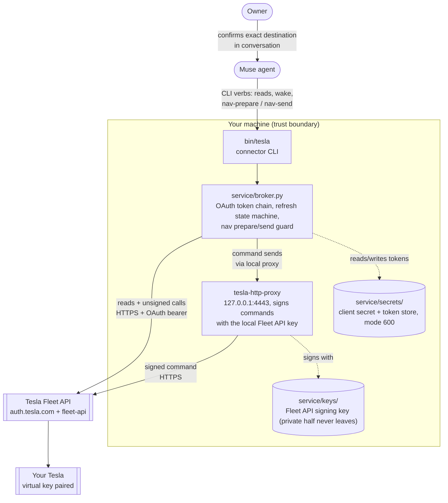

[English](README.md) | **简体中文**

<div align="center">

# Muse Tesla Connector — Free

**托管型的第三方 Tesla 连接器按月收取订阅费——按每辆车收费——还把你的 Tesla 令牌保管在它们的服务器上。这个连接器不会这样：通过 Tesla 官方 Fleet API 把你的 Tesla 接入你的 Muse 智能体，自托管运行，用的是你自己拥有的开发者应用，所有机密都留在你自己的机器上。**

[](LICENSE)
[](https://github.com/LiangGou/muse-tesla-connector/stargazers)

</div>

<p align="center">
  <a href="#功能概览">功能概览</a> •
  <a href="#架构">架构</a> •
  <a href="#安全模型概要">安全模型</a> •
  <a href="#安装步骤">安装步骤</a> •
  <a href="#使用方式">使用方式</a> •
  <a href="#费用">费用</a>
</p>

**一句话版本：**一个小巧的本地 broker 让你的 Muse 智能体拥有对 Tesla 的完整读取权限，外加恰好两个命令——*唤醒*，以及*发送经你先行确认的导航目的地*。代码无法表达任何其他动作。

第三方 Tesla 仪表盘和智能体集成通常按每辆车收取月度订阅费，代价是把你的 Tesla 凭据托管在它们的服务器上。这个项目是自己动手的替代方案：一个小巧的本地 broker 程序，使用你自己的开发者应用与 Tesla 官方 Fleet API 通信，只向你的 Muse 智能体暴露一个刻意做小的命令面，并把所有机密都留在你的磁盘上。

> 状态：可用的参考实现，作者每天都在自己的 Muse 智能体上实际使用。Python 3.10+，无第三方 Python 依赖（仅标准库）。签名代理是 Tesla 官方的 `tesla-http-proxy`，来自 [vehicle-command](https://github.com/teslamotors/vehicle-command) 仓库，需要你自行构建或下载——本仓库不附带它。

## 亮点

- **读取 + 恰好两个命令** —— 完整的车辆读取能力，而 broker 能表达的全部动作只有*唤醒*和*发送导航目的地*。代码里不存在其他命令。
- **每次发送都要车主确认** —— 导航流程是：准备 → 展示确切目的地 → 用一次性令牌确认 → 发送。没有静默发送。
- **机密从不离开你的机器** —— OAuth 令牌、客户端密钥（client secret）和签名密钥都保存在本地权限为 600 的存储中；对外公布的只有公钥。
- **每月 $0** —— 你自己的 Tesla 开发者应用加上按量付费的 Fleet API，替代按车收取的订阅费。

## 目录

- [功能概览](#功能概览)
- [为什么做这个项目](#为什么做这个项目)
- [架构](#架构)
- [安全模型概要](#安全模型概要)
- [前置条件](#前置条件)
- [安装步骤](#安装步骤)
- [使用方式](#使用方式)
- [费用](#费用)
- [局限性](#局限性)
- [致谢](#致谢)
- [许可证](#许可证)

## 功能概览

- **读取**：电量与充电状态、座舱温度、里程表、驾驶状态、车辆位置（含 GPS 新鲜度）、原始车辆数据、车队/钥匙状态，以及 `doctor` 健康检查。
- **命令——恰好两个**：唤醒车辆，以及发送导航目的地。导航是一个两步式的、需车主确认的流程：智能体先准备好确切的目的地并展示给你，你确认之后才会使用一次性令牌发送。
- **没有别的。** 没有锁车、空调、充电、后备箱或驾驶类命令——不是隐藏了，也不在计划中。broker 根本无法表达这些命令（见 [SECURITY.md](SECURITY.md)）。

## 为什么做这个项目

在一次开车途中，作者让他的 Muse 智能体提前点一杯咖啡，并把目的地发送到车上。两件事 Muse 都做不到：它根本访问不了这辆车。当时可用的第三方连接器走的是一个托管服务，按每辆车收取月费，还要托管 Tesla 令牌。于是取而代之的是：在一个语音驱动的会话里，Muse 和车主一起注册了 Tesla 开发者应用，设置了域名和签名密钥，并写出了这个连接器。新增的经常性成本总计：$0（Tesla 的 Fleet API 按量付费，并提供一小笔月度抵扣，日常个人使用绰绰有余；见"费用"一节）。这个项目要替代的，正是那份订阅报价。

|  | 托管型第三方连接器 | 本连接器 |
|---|---|---|
| 费用 | 按月订阅，按每辆车收费 | 每月 $0——用你自己的开发者账户按量付费，并受你设定的账单上限约束 |
| 你的 Tesla 令牌 | 保管在服务商的服务器上 | 从不离开你的机器（本地权限为 600 的存储） |
| 智能体能做什么 | 取决于服务商开放了什么 | 读取，外加唤醒 + 经车主确认的导航——代码里不存在其他命令 |
| 终止开关 | 服务商的账户设置 | 在你手里：移除虚拟钥匙、撤销应用授权，或触及你的账单上限 |

## 架构



**读取流程**：智能体 → `bin/tesla` → broker（按需刷新 OAuth 令牌）→ Fleet API → 汇总后的 JSON 返回给智能体。

**导航流程**：智能体运行 `nav-prepare`（不发送任何车辆命令；它只在本地记录待发目的地并读取车辆状态）→ 车主在对话中确认那段确切文本 → 智能体运行 `nav-send <token>` → broker 在需要时唤醒车辆，然后通过本地签名代理发送一次 → 车辆确认结果。10 分钟内重复发送同一目的地，会被 broker 侧的防重机制拒绝。

## 安全模型概要

完整的安全模型在 [SECURITY.md](SECURITY.md) 中有精确表述（注：SECURITY.md 与 CONNECTOR.md 目前仅提供英文版）。简版如下：

- **构造上最小化**：broker 的命令词汇只有唤醒 + 导航。新增一个动词就必须修改 broker 的代码——不存在可被智能体滥用的"发送任意命令"通道。
- **每次发送都要人工确认**：全新的一次性令牌，与展示给车主的确切目的地文本绑定，10 分钟内有效，只能用一次。
- **机密留在家里**：OAuth 令牌和客户端密钥保存在本地权限为 600 的存储中。Fleet API 签名密钥在本地生成；上传的只有它的公钥部分（上传到由你控制的域名，这是 Tesla 的要求）。
- **终止开关在你手里**：在车上移除虚拟钥匙（virtual key）、在 Tesla 撤销应用的授权，或者依靠 Tesla 开发者门户中的账单上限——每一种方式都能独立切断或限制这条连接。

## 前置条件

1. 一个 Tesla 账户和一辆 Tesla 汽车（Fleet API 的可用性因地区而异；本实现默认面向北美 Fleet API 主机，基础 URL 可配置）。
2. 一个带应用的 **Tesla 开发者账户**（developer.tesla.com）。免费创建。
3. 一个**你能控制的域名**，能通过 HTTPS 提供一个静态文件——Tesla 的合作伙伴注册要求你把 Fleet API 公钥放在 `https://<domain>/.well-known/appspecific/com.tesla.3p.public-key.pem`。GitHub Pages 很适合做这件事。
4. 在 Tesla 开发者门户中**绑定计费方式**，并设置一个由你自定的小额月度上限（Tesla 按请求对 Fleet API 计费；见"费用"一节）。
5. Tesla 官方的 `tesla-http-proxy` 二进制文件，从 [vehicle-command](https://github.com/teslamotors/vehicle-command) 仓库（Go）构建，或从其 Releases 下载。
6. **Python 3.10+** 和 **`openssl`** 命令行工具（broker 会调用 `openssl` 来校验已注册的公钥；代理脚本用它来生成本地 TLS 证书）。
7. 一个支持自定义连接器的 Muse 环境，用于加载 `CONNECTOR.md`（可选——CLI 本身也能独立工作）。

## 安装步骤

下面所有 `tesla ...` 命令都在仓库根目录以 `./bin/tesla ...` 的形式运行——或者把 `bin/` 加入你的 `PATH`，直接调用 `tesla ...`。不带任何动词运行 `./bin/tesla` 会打印完整的使用说明。

1. **创建 Tesla 开发者应用。** 在 developer.tesla.com 创建一个应用。权限范围（scope）请恰好申请这几个：`openid offline_access vehicle_device_data vehicle_location vehicle_cmds`。记下 client ID 和 client secret。在门户里设置一个小额月度账单上限（作者设的是 $10）。在应用设置中，注册你将在 `config.json` 中填写的 redirect URI（第 4 步）——如果授权请求中的 redirect URI 没有在应用上注册，Tesla 会拒绝该请求。
2. **生成 Fleet API 密钥对。** broker 要求私钥放在 `service/keys/tesla-fleet-private-key.pem`，公钥放在 `service/public-key-staging/com.tesla.3p.public-key.pem`。用 `openssl` 创建这两者（这正是 Tesla Fleet API 文档使用的命令；vehicle-command 仓库的 `tesla-keygen` 工具是另一个选择）：

   ```console
   $ mkdir -p service/keys service/public-key-staging
   $ umask 077   # the private key is mode 600 from the moment it is created
   $ openssl ecparam -name prime256v1 -genkey -noout -out service/keys/tesla-fleet-private-key.pem
   $ openssl ec -in service/keys/tesla-fleet-private-key.pem -pubout -out service/public-key-staging/com.tesla.3p.public-key.pem
   $ chmod 600 service/keys/tesla-fleet-private-key.pem
   $ chmod 644 service/public-key-staging/com.tesla.3p.public-key.pem   # public half: publishable, keep it readable for your web host
   ```

   这两个路径都已被 gitignore。**私钥只能以加密形式备份**（例如用 `openssl enc`），口令请存放在密码管理器里——丢失这把钥匙就必须重新配对。
3. **托管公钥。** 把公钥文件发布到 `https://<your-domain>/.well-known/appspecific/com.tesla.3p.public-key.pem`，并确认该 URL 能正常打开。
4. **配置连接器。** 把 `service/config.example.json` 复制为 `service/config.json`，填入你的 client ID、VIN、域名、redirect URI，以及（如果不在北美）Fleet API 基础 URL。也可以使用 `service/broker.py` 中列出的 `TESLA_*` 环境变量。
5. **存入 client secret。** 运行 `python3 service/setup_wizard.py`，打开它打印的回环（loopback）URL，粘贴 client secret。它会被写入 `service/secrets/client-secret.txt`（权限 600），向导随后退出。这个机密永远不会被输入到聊天里。
6. **向 Tesla 注册你的域名（合作伙伴注册）。** 这是一次性的调用：用合作伙伴令牌（client credentials 模式）调用 Tesla 的 `partner_accounts` 端点。broker 没有为它提供动词——注册很少变更，结果可以用 `tesla partner-check` 验证。请严格按下面的方式运行（密钥从本地存储读入一个 shell 变量；它不会被打印或记录，不过在调用执行期间，它——以及注册调用中的合作伙伴令牌——会短暂地出现在这个 shell 的进程列表中；这套安装流程本就应在你自己可信的机器上运行）：

   ```console
   $ CLIENT_SECRET=$(cat service/secrets/client-secret.txt)
   $ PARTNER_TOKEN=$(curl -sf -X POST https://auth.tesla.com/oauth2/v3/token \
       -d grant_type=client_credentials --data-urlencode "client_id=<YOUR_CLIENT_ID>" \
       --data-urlencode "client_secret=$CLIENT_SECRET" \
       -d audience=https://fleet-api.prd.na.vn.cloud.tesla.com \
       --data-urlencode 'scope=openid vehicle_device_data vehicle_location vehicle_cmds' \
       | python3 -c 'import json,sys; print(json.load(sys.stdin).get("access_token", ""))' 2>/dev/null)
   $ test -n "$PARTNER_TOKEN" && curl -sf -X POST https://fleet-api.prd.na.vn.cloud.tesla.com/api/1/partner_accounts \
       -H "Authorization: Bearer $PARTNER_TOKEN" -H 'Content-Type: application/json' \
       -d '{"domain": "<YOUR_DOMAIN>"}' \
       || echo "STOP: registration did not complete — check the partner token first, then retry"
   $ unset CLIENT_SECRET PARTNER_TOKEN
   $ ./bin/tesla partner-check   # registered_key_matches must be true
   ```

   如果 `PARTNER_TOKEN` 返回为空，说明令牌请求失败了——在运行注册 POST 之前，先复查 client ID、scope 列表和 audience。如果你配置了非默认的 `fleet_base`（北美以外），请在 `audience` 和注册 URL 中都使用那个主机。
7. **授权应用（一次浏览器登录）。** 在浏览器中打开下面的 URL（填入你的 client ID，并把你的 redirect URI 做 URL 编码——例如 `https%3A%2F%2Fyour-domain.example.com%2Fauth%2Fcallback`），以车主身份登录并批准：

   ```text
   https://auth.tesla.com/oauth2/v3/authorize?client_id=<YOUR_CLIENT_ID>&redirect_uri=<YOUR_REDIRECT_URI>&response_type=code&scope=openid%20offline_access%20vehicle_device_data%20vehicle_location%20vehicle_cmds&state=setup
   ```

   Tesla 会把浏览器重定向到你的 redirect URI，并在查询字符串中带上授权码（`<redirect_uri>?code=<CODE>&state=setup`）。从地址栏复制 `code` 的值——它几分钟内就会过期——并做一次性兑换：`tesla exchange-code <code>`。此后，刷新令牌链就由 broker 接管了。
8. **在车上配对虚拟钥匙。** Tesla 的流程会给你一个链接（`https://tesla.com/_ak/<your-domain>`），在 Tesla App 或车机里打开它，即可把你的公钥配对为用于命令签名的虚拟钥匙。用 `tesla key-status` 验证——Tesla 会在 `key_paired_vins` 下报告你的 VIN。
9. **构建/放置 `tesla-http-proxy`**，并把 `TESLA_HTTP_PROXY_BIN` 设为它的路径（或者把它加入 `PATH`）。broker 通过 `service/run-proxy.sh` 按需启动它。
10. **验证。** 运行 `tesla doctor`——密钥、公钥 URL、合作伙伴注册、令牌存储和 VIN 这几项检查都应报告健康。有一个例外属预期之内：`proxy_health` 在第一次导航发送之前会读作 `false`，因为 broker 是按需启动代理的——**这是正常现象，不是故障**。然后运行 `tesla status` 和 `tesla location`。接着，趁你在车旁边时做一次仔细的端到端导航测试：`tesla nav-prepare <一个附近的地址>`，把目的地读回来，确认，`tesla nav-send <token>`，并看着目的地出现在车载屏幕上。
11. **演练终止开关**（见 SECURITY.md）：做一次——在车上移除虚拟钥匙，确认命令失败，然后重新配对。请在*依赖*这个连接器之前做这件事，而不是在事故之后。

如果你使用 Muse 智能体，请把本仓库的 `CONNECTOR.md`（以及 `connector.yaml`）作为自定义连接器指给它——那份文档包含智能体必须遵守的操作与安全规则。

## 使用方式

```console
$ tesla doctor          # health of secret, key hosting, registration, tokens, proxy
$ tesla status          # battery, charging, temperature, odometer, drive state
$ tesla location        # lat/lon, heading, GPS freshness
$ tesla nav-prepare "2001 Geary Blvd, San Francisco"
# -> { "destination": "...", "vehicle_state": "online", "confirm_token": "...", ... }
$ tesla nav-send <token>   # only after the owner confirms the exact destination
```

## 费用

Tesla Fleet API 按量付费（例如，车辆数据请求按次计费，命令/唤醒调用的单价更高），计入你的开发者账户；Tesla 还提供一小笔月度抵扣（历史上为 $10），普通个人使用基本用不完。第 1 步中设置的账单上限封顶了最坏情况。除此之外没有任何经常性成本：没有订阅，没有托管服务。

## 局限性

- 每个 broker 实例固定一辆车（账户下的其他车辆可以列出；在配置里换一个 VIN 即可切换）。
- 车辆休眠时返回的是缓存数据，可能没有位置信息；读取会如实报告数据的新鲜度，而不是假装成实时数据。
- 导航目的地以文本（或原始 GPS 坐标）发送；由车辆自身的搜索/地理编码来解析，地名有可能解析到名称相近的错误地址——这正是 prepare 步骤要展示确切文本让你确认的原因。
- Fleet API 的行为、定价与区域可用性由 Tesla 决定，未来可能变化；本连接器默认面向文档中记载的北美端点。
- 主机被完全攻陷时，本地防护将无能为力。这个连接器降低的是第三方与智能体带来的风险；它不能让一台已被攻陷的机器变安全。见 SECURITY.md。

## 致谢

这款连接器由 Muse（Meta 的个人 AI 智能体）编写代码。想法、故事和提示词属于作者本人；代码出自 Muse 之手——在一个语音驱动的会话中完成，全程遵循作者的指导、裁定与确认。

**如果这个连接器帮你省下了一份订阅费，不妨给仓库点一颗 ⭐**——这能帮其他同时使用 Muse 和 Tesla 的车主找到它。

## 许可证

MIT——见 [LICENSE](LICENSE)。
